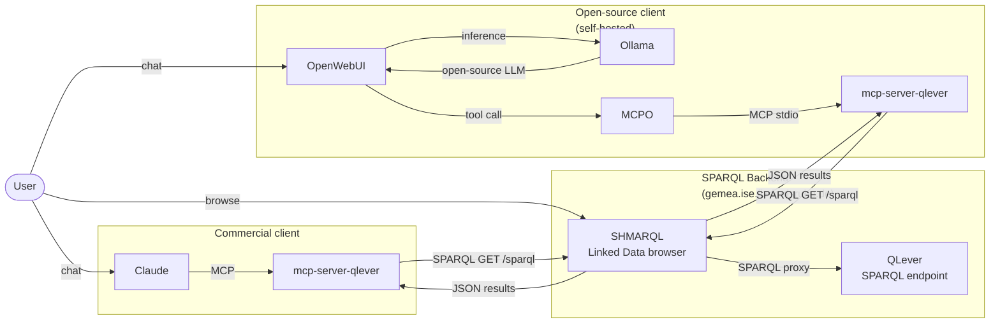

# GEMEA: German Memory Atlas

GEMEA is a knowledge graph over approximately 27.5 million digitised objects from the [German Digital Library](https://www.deutsche-digitale-bibliothek.de/) (DDB), aligned to the [mocho](https://github.com/ISE-FIZKarlsruhe/mocho) mid-level ontology and indexed in [QLever](https://github.com/ad-freiburg/qlever) for high-performance SPARQL querying.
The alignment of DDB metadata to mocho classes and properties is documented in the [GEMEA Alignment Writeup](https://gemea.ise.fiz-karlsruhe.de/05-alignment).
The corpus is served through [SHMARQL](https://github.com/epoz/shmarql) as a dereferenceable Linked Data browser and SPARQL endpoint, and is queryable by AI agents via [mcp-server-qlever](https://github.com/xorwell/mcp-server-qlever).

> Presented at: Mary Ann Tan. **GEMEA: Germany's Cultural Memory as a Linked Knowledge Graph.** *SWIB26: Semantic Web in Libraries*, online, 18 November 2026.

---

## 1. Downloads & endpoints

| Resource | URL |
|---|---|
| GEMEA N-Quads dump | <https://gemea.ise.fiz-karlsruhe.de/downloads/gemea> |
| Goethe-Faust corpus (JSON + N-Quads) | <https://gemea.ise.fiz-karlsruhe.de/downloads/goethe-faust/> |
| SHMARQL Linked Data browser | <https://gemea.ise.fiz-karlsruhe.de/> |
| SPARQL endpoint | <https://gemea.ise.fiz-karlsruhe.de/sparql> |

### 1.1 Dump layout

`https://gemea.ise.fiz-karlsruhe.de/downloads/gemea/`

| Path | Contents |
|---|---|
| `nq/sN.nq`, `nq/sN-<offset>.nq` | N-Quads per DDB sector, split into shards of ~4 GB (112 files, ~474 GB in total) |
| `nq/prov-shared.nq` | Provenance shared across sectors |
| `nq/werk-links/` | GND Werk links (`gnd-work-links-<timestamp>.nq`) and their provenance |
| `duckdb/` | Label lookup tables (agents, concepts), provenance, and GND Werk staging tables per sector |
| `stats/sN-stats.json` | Per-sector transform statistics (records, media types, hierarchy types) |
| `logs/` | Transform logs and error files per sector |
| `archive/<yyyymmdd>/` | Statistics of earlier releases |

| Prefix | Sector | Objects | Shards | Size |
|---|---|---:|---:|---:|
| `s1` | Archive | 3,638,021 | 20 | 85 GB |
| `s2` | Library | 18,570,245 | 50 | 295 GB |
| `s3` | Monument Preserv. | 83,572 | 1 | 1.5 GB |
| `s4` | Research | 1,227,252 | 10 | 21 GB |
| `s5` | Media Library | 1,799,838 | 15 | 38 GB |
| `s6` | Museum | 2,117,728 | 15 | 31.5 GB |
| `s7` | Others | 89,904 | 1 | 1.5 GB |

---

## 2. Resource statistics

Object and triple counts per sector.

| Sector | Objects | Total triples | DDB-EDM | MOCHO | PROV |
|---|---:|---:|---:|---:|---:|
| Library | 18,570,245 | 1,981,590,317 | 1,043,156,260 | 398,850,679 | 539,583,378 |
| Archive | 3,638,021 | 501,431,917 | 271,272,035 | 76,478,457 | 153,681,414 |
| Museum | 2,117,728 | 237,492,790 | 121,768,266 | 54,294,081 | 61,414,768 |
| Media Library | 1,799,838 | 263,104,795 | 142,865,860 | 64,023,886 | 56,215,049 |
| Research | 1,227,252 | 146,191,553 | 78,275,686 | 28,281,400 | 39,634,464 |
| Monument Preserv. | 83,572 | 9,628,501 | 5,086,627 | 1,789,244 | 2,752,630 |
| Others | 89,904 | 10,545,972 | 5,619,439 | 2,242,076 | 2,684,457 |
| **Total** | **27,526,560** | **3,149,985,845** | **1,668,044,173** | **625,959,823** | **855,966,160** |

The QLever index is organised into four named graphs:

| Named graph | Contents |
|---|---|
| `graph/ddbedm` | Verbatim EDM passthrough |
| `graph/mocho` | mocho-aligned triples |
| `graph/prov` | PROV-O provenance |
| `graph/work` | GND work links |

---

## 3. Pipeline

**Ingest (build-time)**

```
DDB Search API ──► fetch IDs ──► fetch JSON records
                                       │
                                       ▼
                              SQLite (per sector)
                                       │
                         scripts/transform/ (Phase 1)
                         EDM → mocho alignment
                                       │
                                       ▼
                              N-Quads (named graphs)
                                       │
                              qlever index build
```

**GND Werk linking (build-time, library sector)**

```
library records ──► title spans (ISBD rule, Flair) ──► GND Work candidates ──► links
  (Parquet)          scripts/py/extract_werk_spans.py   scripts/py/link_gnd_local.py
                                       │
                                       ▼
                    N-Quads in graph/work, provenance in graph/prov
                    scripts/werk-linking/write_werk_rdf.py
```

Steps, inputs and evaluation scripts: [`scripts/README.md`](scripts/README.md).

**Access (runtime)**



**Goethe-Faust POC.** The alignment and dispatch logic were developed and validated on the [Goethe-Faust corpus](goethe-faust/) (115,432 DDB records retrieved via the keywords *Goethe* and *Faust*) before scaling to the full 27.5M-object collection. The corpus analysis scripts, outputs, and design decisions are in [`goethe-faust/`](goethe-faust/).

---

## 4. Directory structure

```
gemea/
├── docker-compose.qlever.yml    QLever + SHMARQL + MCPO (SPARQL backend)
├── config.env.example           Settings template for docker-compose.qlever.yml (§5.2)
├── docker-compose.openwebui.yml OpenWebUI chat UI (open-source client)
├── config/transform/            Lookup tables consumed by the transform
├── scripts/
│   ├── README.md                Both pipelines, script by script
│   ├── transform/               EDM → mocho transform package, drivers, config generators
│   ├── py/                      GND Werk linking: steps 0 to 2 and evaluation
│   ├── werk-linking/            GND Werk links and their provenance as RDF; QLever loader
│   ├── sh/                      Local GND SPARQL server
│   └── tests/                   Tests of scripts/py/
├── goethe-faust/                Goethe-Faust reference corpus
│   ├── config.env.example       Settings template for the Goethe-Faust compose files
│   ├── docker-compose.qlever.yml    QLever + SHMARQL for the Goethe-Faust corpus
│   ├── docker-compose.shmarql.yml   SHMARQL (pyoxigraph) for the Goethe-Faust EDM data
│   ├── scripts/                 Data acquisition + corpus analysis scripts
│   ├── output/                  Corpus analysis outputs (CSVs, PNGs, JSONs)
│   └── data/                    Corpus sample (IDs + 1K-record excerpt)
├── requirements.txt             Python dependencies for the config generators and Goethe-Faust scripts
├── requirements-transform.txt   Transform runtime
├── requirements-linking.txt     GND Werk linking (Flair, torch)
├── CITATION.cff
├── LICENSE                      MIT (code)
└── LICENSE-DATA                 CC BY 4.0 (data)
```

---

## 5. Self-hosting

The SPARQL endpoint is available at `https://gemea.ise.fiz-karlsruhe.de/sparql`; no setup is required to query it. The Linked Data browser is at `https://gemea.ise.fiz-karlsruhe.de/`. For the LLM client, choose between a commercial option (Claude) or a fully open-source option (Ollama + OpenWebUI).

### 5.1 LLM client

**Option A: Commercial (Claude)**

Requires Docker. Add to `.mcp.json` in your project root (Claude Code), or to `claude_desktop_config.json` (Claude Desktop):
```json
{
  "mcpServers": {
    "gemea-qlever": {
      "command": "docker",
      "args": ["run", "--rm", "-i", "--platform", "linux/amd64",
               "ghcr.io/xorwell/mcp-server-qlever:latest",
               "-e", "https://gemea.ise.fiz-karlsruhe.de/sparql"]
    }
  }
}
```

Or register it from the command line: `claude mcp add gemea-qlever -- docker run --rm -i --platform linux/amd64 ghcr.io/xorwell/mcp-server-qlever:latest -e https://gemea.ise.fiz-karlsruhe.de/sparql`

**Option B: Open-source (Ollama + OpenWebUI)**

Requires Docker. Ollama must run natively on macOS, because Docker Desktop does not expose Apple Silicon GPU (Metal) to containers.

1. Install [Ollama](https://ollama.com/download) and pull a model: `ollama pull gemma4:e4b`
2. Start MCPO, which exposes the MCP server's tools over HTTP:
   ```bash
   docker run -d -p 127.0.0.1:2344:8001 ghcr.io/open-webui/mcpo:latest --port 8001 -- \
     npx -y mcp-server-qlever -e https://gemea.ise.fiz-karlsruhe.de/sparql
   ```
3. Start OpenWebUI: `docker compose -f docker-compose.openwebui.yml up -d`
4. Open `http://localhost:3000` and create an admin account
5. Add MCPO as a tool server: **Admin Panel → Settings → Integrations → Manage Tool Servers → +**
   - URL: `http://host.docker.internal:2344` (check for a trailing space; it breaks the connection)
   - Auth: None (leave the key empty)
   - Click ↻ to verify, then **Save**

   Use the admin-level setting, not the user-level **Settings → Integrations**: user-level tool servers are called from the browser and may return empty results.
6. In a new chat with `gemma4:e4b`, open **Controls** (sliders icon, top right):
   - **Advanced Params → Function Calling: Native**. In the default mode the model often stops before answering.
   - **System Prompt**:
     ```
     You answer questions about the German Memory Atlas (GEMEA), a knowledge graph of DDB cultural heritage objects, using the sparql_query tool.
     Always declare prefixes. Useful ones:
     PREFIX edm: <http://www.europeana.eu/schemas/edm/>
     PREFIX dc: <http://purl.org/dc/elements/1.1/>
     PREFIX ore: <http://www.openarchives.org/ore/terms/>
     Aggregates need an alias: SELECT (COUNT(?s) AS ?n).
     To count or list objects of a class, use ?s a <class>, e.g. ?s a edm:ProvidedCHO. Never invent properties; if unsure, first query the predicates of one example object.
     GEMEA schema (EDM):
     - Objects: ?cho a edm:ProvidedCHO; dc:title, dc:language ("ger", "lat", ...), edm:type ("TEXT", "IMAGE", "SOUND", "VIDEO", "3D").
     - Institution and rights are on the aggregation: ?agg edm:aggregatedCHO ?cho ; edm:dataProvider ?provider ; edm:rights ?r.
       edm:dataProvider has both a name literal and an organisation IRI; always add FILTER(isLiteral(?provider)) when grouping by institution, or each institution is counted twice.
     - The endpoint times out after 30 s: avoid text filters (CONTAINS/REGEX) over all titles.
     Report only numbers the tool returns; if the tool returns nothing or an error, say so.
     ```
7. Enable the tools with the wrench icon below the message box and ask: *"How many cultural heritage objects (edm:ProvidedCHO) are in GEMEA?"* Expected answer: 27,526,560.

Small local models write weaker SPARQL than Claude: if an answer looks wrong, regenerate it or check the query under **Explored → sparql_query**.

### 5.2 Running everything locally (test)

To run QLever, SHMARQL, and MCPO on your own machine instead of using the hosted endpoint, download the N-Quads dump and use `docker-compose.qlever.yml`. Its QLever settings match the hosted deployment; all ports bind to `127.0.0.1`.

**1. Download the N-Quads dump**
All sectors take ~474 GB (see §1.1); for a first test, download one small sector such as `s3` (1.5 GB).
```bash
B=https://gemea.ise.fiz-karlsruhe.de/downloads/gemea/nq/
# list the files; add `| grep '^s3'` before `> nq-files.txt` to fetch one sector only
curl -s -H 'Accept: application/json' "$B" \
  | python3 -c 'import json,sys; [print(e["name"]) for e in json.load(sys.stdin) if e["name"].endswith(".nq")]' \
  > nq-files.txt
# download (resumable)
xargs -I{} curl -C - -O "$B{}" < nq-files.txt
```
The GND Werk links in `nq/werk-links/` are not included; download them separately if needed.

**2. Configure**
```bash
cp config.env.example config.env
# Set NQ_INPUT_DIR, INDEX_DIR, UID/GID (id -u, id -g), and ports in config.env
```
The QLever limits in `config.env.example` (`QLEVER_MEMORY=50G`, `QLEVER_CACHE=15G`) are those of the hosted deployment; lower them when you load only one sector.

**Before running**
- [ ] `NQ_INPUT_DIR` exists and contains the downloaded `.nq` files
- [ ] `INDEX_DIR` exists and is writable by `UID:GID`
- [ ] Ports `QLEVER_PORT`, `SHMARQL_PORT`, and `MCPO_PORT` are free on the host

**3. Build the index (once)**
```bash
docker compose --env-file config.env -f docker-compose.qlever.yml run --rm qlever-index
```

**4. Start**
```bash
docker compose --env-file config.env -f docker-compose.qlever.yml up -d --wait
```

SPARQL endpoint: `http://localhost:2343` · SHMARQL browser: `http://localhost:2342` · MCPO: `http://localhost:2344` (defaults; adjust in `config.env`). SHMARQL needs about 20 s after start before it answers.

To make the endpoint public, put a reverse proxy with TLS in front of SHMARQL only; do not expose QLever, Redis, or MCPO directly.

---

## 6. License

| Component | License |
|---|---|
| Code (scripts, transform, compose files) | [MIT](LICENSE) |
| Data (KG dump, lookup tables, statistics, Goethe-Faust outputs) | [CC BY 4.0](LICENSE-DATA) |
| Digital objects referenced by the KG | Per object, given in `edm:rights` and `dcterms:rights` |

---

## 7. Troubleshooting

**T1. `Permission denied` writing to `/index`**
The `UID:GID` set in `config.env` cannot write to `INDEX_DIR`. Create the directory and give it to that user:
```bash
mkdir -p "$INDEX_DIR" && sudo chown "$(id -u):$(id -g)" "$INDEX_DIR"
```

**T2. `required variable INDEX_DIR is missing a value: set INDEX_DIR in config.env`** (or `NQ_INPUT_DIR`)
`NQ_INPUT_DIR` or `INDEX_DIR` is not set. Check that `config.env` contains valid paths and that you pass `--env-file config.env`.

**T3. `ERROR: no files matched /input/*.nq`**
No `.nq` file in `NQ_INPUT_DIR`, or `NQ_INPUT_GLOB` matches nothing. Check the directory against the file list in §1.1.

**T4. Port already in use**
Change `QLEVER_PORT`, `SHMARQL_PORT`, or `MCPO_PORT` in `config.env` to a free port. To check whether ports 2342 to 2344 are already in use on the host:
```bash
ss -tlnp | grep -E '234[234]'
```
These ports are IANA-registered (nati-logos, fcmsys) but rarely used in practice. If they are taken, pick any free port between 2000 and 9000 that is not a well-known service.

**T5. `dependency failed to start`**
Root cause is always in the QLever logs:
```bash
docker compose --env-file config.env -f docker-compose.qlever.yml logs qlever
```

---

## 8. Caveats

- The Goethe-Faust POC covers 115,432 records; the full GEMEA corpus covers 27.5M objects.
- GND Werk linking (Phase 1b) is partial; the `graph/work` named graph may be incomplete.
- NER enrichment (Phase 2) is deferred and not included in this release.
- Resource metadata (VoID descriptor, DCAT record, persistent URI) is not yet available.

---

## 9. Citation

```bibtex
@misc{tan2026swib,
  author       = {Tan, Mary Ann},
  year         = {2026},
  month        = nov,
  title        = {{GEMEA: Germany's Cultural Memory as a Linked Knowledge Graph}},
  howpublished = {{Presentation at SWIB26: Semantic Web in Libraries, online, 18 November 2026}}
}
```
