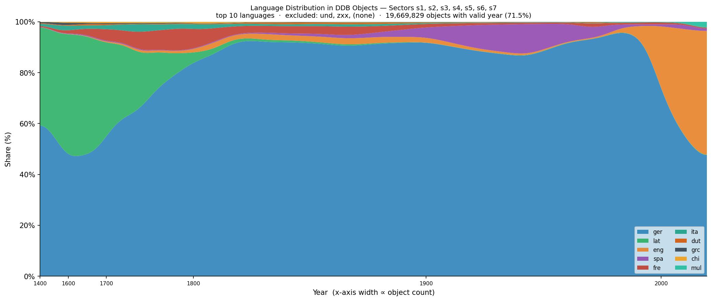
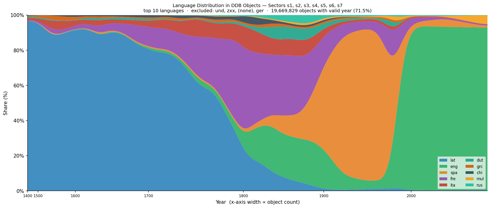
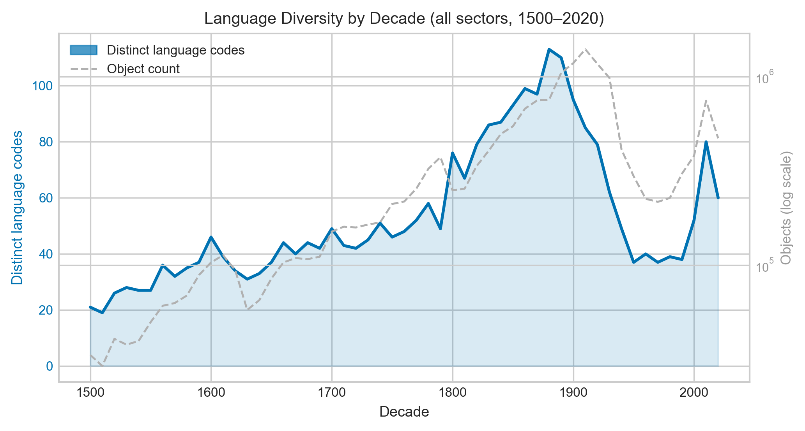
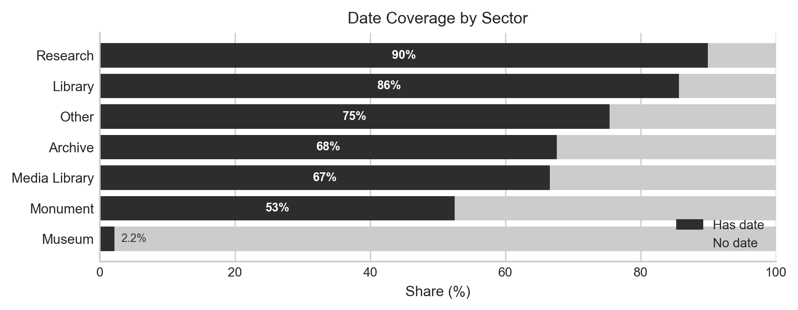
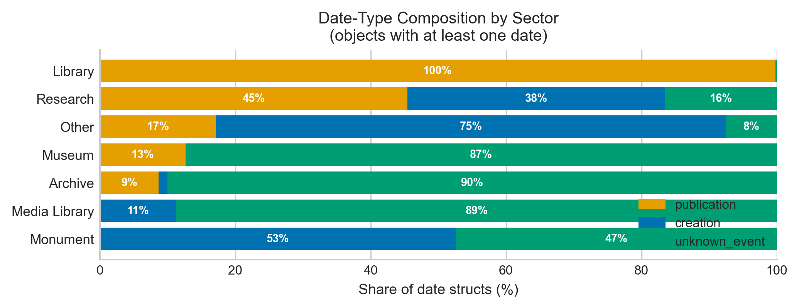

# Languages and Dates Across Sectors

## 1. Scope

`lang_obj` is populated from `ProvidedCHO.language` or `dcTermsLanguage`; where absent, the title's language tag (`lang_title`) is used as a fallback. Both fields are written as empty strings rather than NULL when no language declaration exists in the source record, so the 8.2% of objects with no resolved language (2,254,502) reflects genuine metadata absence rather than an ingest artifact. Year is extracted from the `dates` list of structs — preferring `creation` events, then `publication`, then untyped LIDO events, and within each struct preferring `begin` over `value` — and must fall in 1400–2026 to be accepted. The codes `und` and `zxx` are excluded from all language analyses.

| Metric | Value |
|--------|-------|
| Total objects | 27,526,560 |
| Objects with no language declaration | 2,254,502 (8.2%) |
| Distinct language codes (excl. none/und/zxx) | 251 |
| Objects with valid year | 19,669,829 (71.5%) |
| Objects without valid year (excluded from temporal analysis) | 7,856,731 (28.5%) |

## 2. German dominates across periods; Latin precedes it

German (`ger`) is the largest language in the corpus by a wide margin, followed by Latin (`lat`), English (`eng`), Spanish (`spa`), and French (`fre`). The Marimekko chart maps language share against time with x-axis width proportional to object volume: the pre-1900 period is narrow, reflecting sparse holdings, while the post-1950 decades carry the bulk of Library's 16 million objects. Within that mass, German's share is near-total. Removing German reveals the underlying distribution: Latin holds the pre-modern period, then cedes to Western European languages from the eighteenth century onward as print collections expand.

The 251 distinct codes are not evenly distributed through time. The diversity chart plots distinct language codes per decade (left axis) against object volume on a log scale (right axis), separating the structural diversity of the corpus from the sheer weight of the Library sector.

## 3. Date coverage ranges from 2.2% to 89.9% across sectors

The 71.5% corpus-wide year coverage masks variation from 2.2% in Museum to 89.9% in Research. Library alone contributes 15.9 million of the 19.7 million dated objects, so the overall rate is largely a Library figure. Museum's 45,871 dated objects out of 2,117,728 total reflect the DDB EDM model: physical holdings in that sector carry catalogue records that do not include date fields at the object level. Any period-filtered retrieval that operates corpus-wide silently excludes the Museum collection in full.

Monument (52.5%) and Archive (67.6%) have gaps for different reasons. Monument's cataloguing is often incomplete at the date field level; Archive's gaps reflect repositories that have not populated the date slots in their LIDO-formatted records, rather than objects that genuinely lack temporal context.

## 4. Date-type structure reflects each sector's cataloguing convention

The type of date struct — `creation`, `publication`, or `unknown_event` — is not uniform across sectors, and its distribution traces how each sector's source institutions model temporal metadata. Library's 16 million date structs are 99.8% `publication`, drawn from `dc:issued`, consistent with bibliographic cataloguing practice. Archive's dated objects are dominated by `unknown_event` (2,213,722 structs), LIDO events whose type URI falls outside the recognised set; its `publication` structs (213,132) come from finding aids rather than archival objects. Research is the most evenly distributed sector: 437,904 creation, 521,720 publication, and 189,515 unknown_event, reflecting the mix of journal articles, digitised publications, and event-linked records across research repositories.

Monument produces no `publication` structs — its 46,512 date structs split between `creation` (24,444) and `unknown_event` (22,068) — because preservation records express temporal information as creation or survey dates, not publication events. Media Library mirrors Archive structurally: `unknown_event` dominates (1,109,988 structs) because its media objects are linked through LIDO event chains whose type URIs are not in the recognised set. For GeMeA's temporal queries, `publication` is the reliable date signal in Library and Research; outside those sectors, `unknown_event` structs must be parsed further or treated as approximate.
