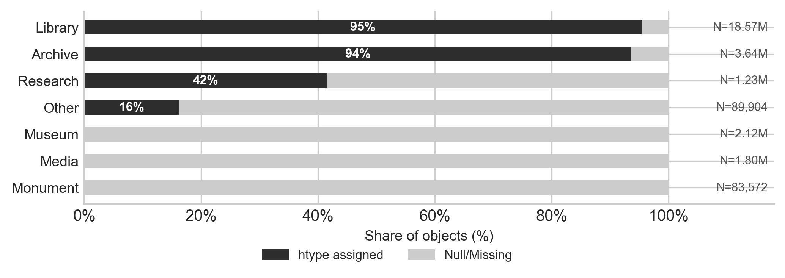
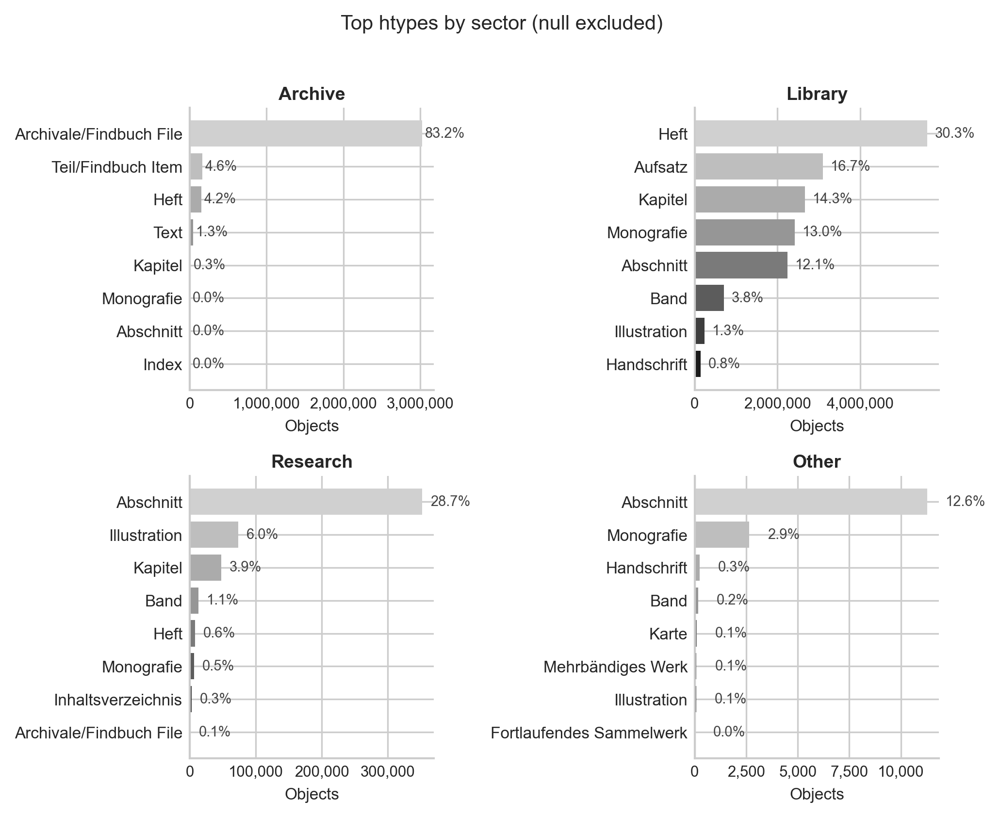
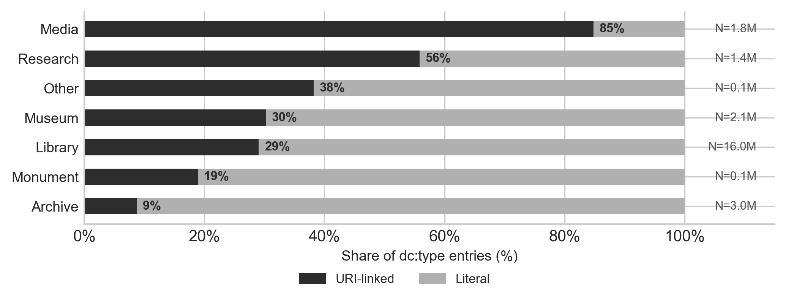
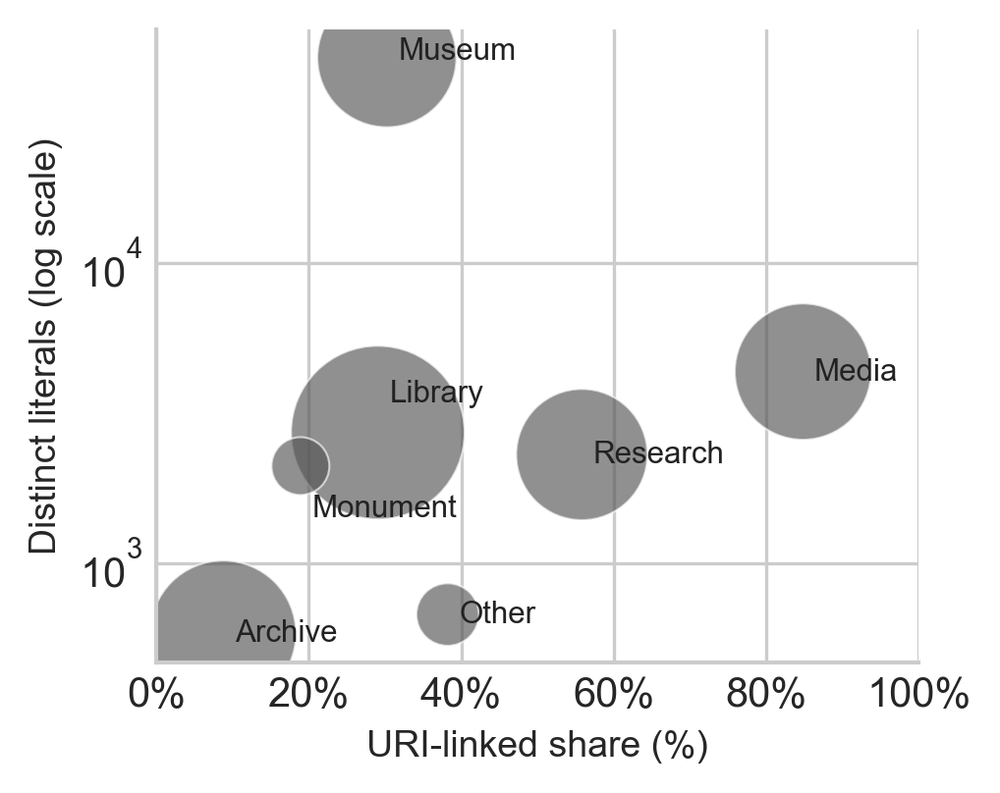
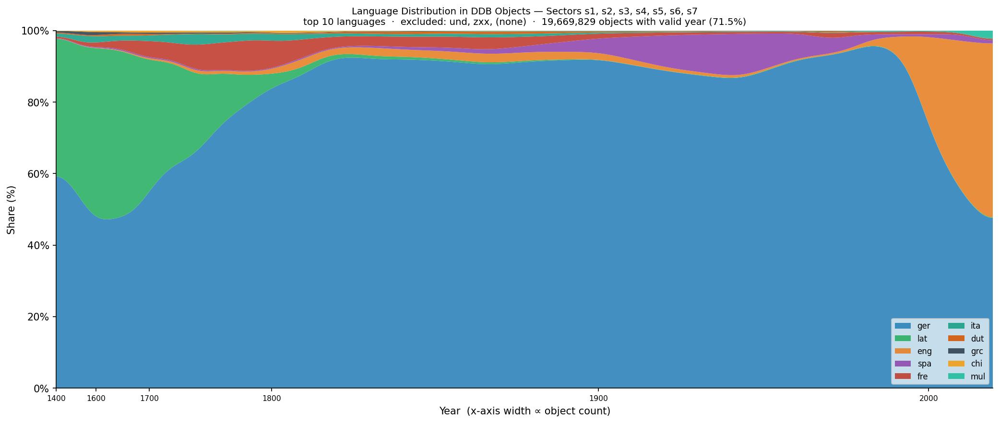
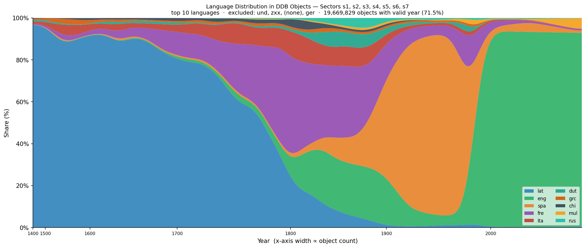
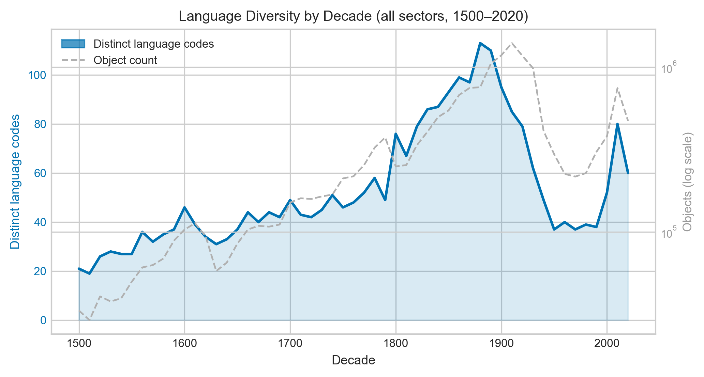
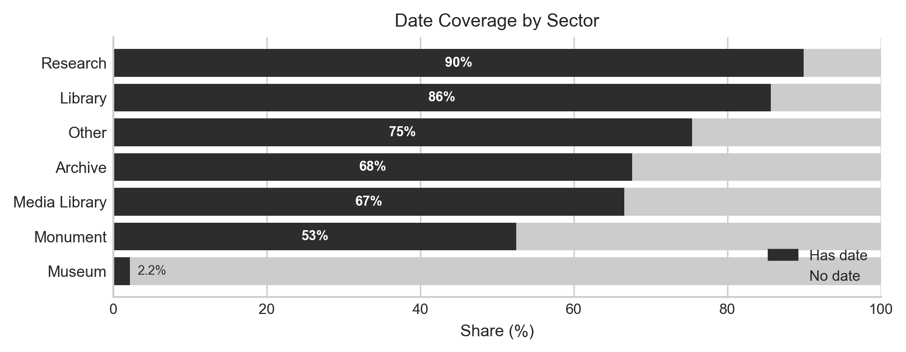
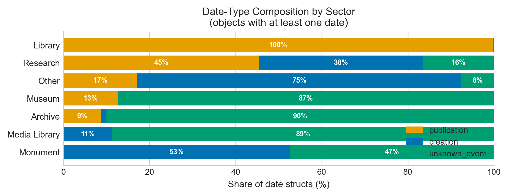

# Aligning DDB Metadata to mocho

## 1. Source

The DDB distributes its metadata holdings as a Cortex export: seven SQLite files (`s1.sqlite`–`s7.sqlite`), one per sector, each obtained via a pull from the DDB API. Each file contains a single `objs` table; each row holds one gzip-compressed Cortex JSON-LD blob in the `bufgz` column. The seven files together cover 65.3 million objects, of which 27.3 million carry digitized surrogates (as of March 2026).

| Sector | SQLite | Objects | Digitized |
|--------|--------|--------:|----------:|
| Archive | `s1.sqlite` | 36,170,381 | 3,486,444 |
| Library | `s2.sqlite` | 23,734,627 | 18,570,245 |
| Monument | `s3.sqlite` | 115,727 | 83,575 |
| Research | `s4.sqlite` | 1,276,653 | 1,223,929 |
| Media Library | `s5.sqlite` | 1,801,719 | 1,799,840 |
| Museum | `s6.sqlite` | 2,114,461 | 2,011,737 |
| Other | `s7.sqlite` | 99,161 | 89,904 |
| **Total** | | **65,312,729** | **27,265,674** |

`prescan.py` (Pass 1 of the two-pass transform) decompresses and parses each blob and writes a flat metadata Parquet file per sector (`s<N>_meta.parquet`). These Parquet files are the working surface for all corpus analysis. See [01-parquet-source.md](01-parquet-source.md) for the pipeline, 15-column schema, and field extraction notes.

---

## 2. Why corpus analysis was necessary for the alignment

The alignment target — mocho, which maps DDB EDM to RDA/FRBR — requires deciding which EDM fields are reliable enough to serve as alignment anchors. The Cortex schema describes what fields *exist*; it says nothing about what they contain, how consistently they are populated, or whether their semantics are stable across sectors. Three findings from the corpus analysis showed that those questions could not be answered without empirical inspection.

### 2.1 Coverage is uneven across sectors

`hierarchy_type` (*htype*) — the DDB's structural and bibliographic type classification — has zero coverage in Monument, Media Library, and Museum, and is 84% null in Other. Any alignment rule that treats *htype* as a reliable type signal silently excludes 5.9 million objects (21.4% of the digitized corpus). See [02-mediatype-htype-write-up.md](02-mediatype-htype-write-up.md) §3.

### 2.2 Field semantics are sector-local, not corpus-wide

Where *htype* is populated, Archive and Library use non-overlapping vocabularies: Archive is dominated by EAD-derived codes (Archivale/Findbuch File), while Library distributes across 25 MARC-derived bibliographic types (Heft, Aufsatz, Kapitel, Monografie, Abschnitt). A single alignment rule across both sectors would conflate archival arrangement with bibliographic granularity. The split was only visible after cross-tabulating type distributions per sector. See [02-mediatype-htype-write-up.md](02-mediatype-htype-write-up.md) §4.

### 2.3 Authority linking is heterogeneous

`dc:type`, the primary object-type field, carries either a controlled-vocabulary URI or a free-text literal depending on the contributing institution. Authority-linking rates range from 9% (Archive) to 85% (Media Library) — a nine-fold spread that reflects cataloguing practice, not data quality variation. Museum presents 48,484 distinct literal values, 21 times more than any other sector. The alignment cannot treat `dc:type` uniformly; it must handle URI-linked and literal entries separately, and must know per-sector which share of entries is URI-linked before deciding whether literal normalization is worth the cost. See [03-dc-type-write-up.md](03-dc-type-write-up.md) §2–§4.

### 2.4 Consequence for anchor field selection

Only `mediatype` — five coarse values, populated for > 99.99% of all objects — provides a reliable cross-sector type anchor without gap-filling. `dc:type` adds richer semantics but requires separate URI and literal handling. `hierarchy_type` is suitable only within Library and Archive. The corpus analysis converted these latent risks into quantified trade-offs that inform each alignment decision in mocho.

---

## 3. Language and temporal coverage

Source: [04-lang-by-year-write-up.md](04-lang-by-year-write-up.md).

### 3.1 Language coverage

| Metric | Count | % |
|--------|------:|--:|
| Total rows (all sectors) | 27,526,560 | 100.0% |
| Resolved `(none)` | 2,254,502 | 8.2% |
| Distinct language codes (excl. `none`/`und`/`zxx`) | 251 | — |

Language is resolved from `lang_obj` (object-level ISO 639-2 from `ProvidedCHO.language`) with fallback to `lang_title` (title language tag). Both fields are nominally non-null — `prescan.py` writes an empty string rather than NULL — so the 8.2% `(none)` figure reflects objects where both fields are empty strings.

**Top 10 languages by object count:** `ger`, `lat`, `eng`, `spa`, `fre`, `ita`, `dut`, `grc`, `chi`, `mul`. German dominates strongly across all sectors.

### 3.2 Temporal coverage

Year is extracted from the `dates` column (`DATE_STRUCT` list) using the following priority: `type = "creation"` → `"publication"` → others; within a struct, `begin` before `value`; first four characters parsed as integer, accepted range 1400–2026.

| Metric | Count | % |
|--------|------:|--:|
| Valid year extracted | 19,669,829 | 71.5% |
| No valid year (excluded) | 7,856,731 | 28.5% |

Date-type composition varies strongly by sector:

| date_type | s1 Archive | s2 Library | s3 Monument | s4 Research | s5 Media | s6 Museum | s7 Other |
|---|---:|---:|---:|---:|---:|---:|---:|
| `creation` | 31,854 | 0 | 24,444 | 437,904 | 141,475 | 0 | 63,170 |
| `publication` | 213,132 | 16,014,337 | 0 | 521,720 | 192 | 6,256 | 14,414 |
| `unknown_event` | 2,213,722 | 37,948 | 22,068 | 189,515 | 1,109,988 | 43,257 | 6,325 |
| **% objects with any date** | 67.6% | 85.6% | 52.5% | 89.9% | 66.6% | **2.2%** | 75.4% |

Notable: s6 (Museum) has only 2.2% date coverage — it contributes negligibly to the temporal analysis. s2 (Library) is dominated by `publication` dates; s1 (Archive) by `unknown_event` (LIDO event chains with unrecognised type).

### 3.3 Charts

**Language distribution — all sectors (top 10 languages)**

**Language distribution — German excluded**

**Language diversity by decade**

**Date coverage by sector**

**Date-type composition by sector**

