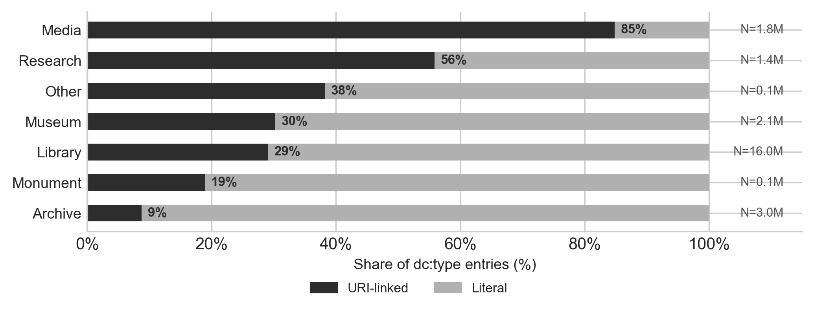
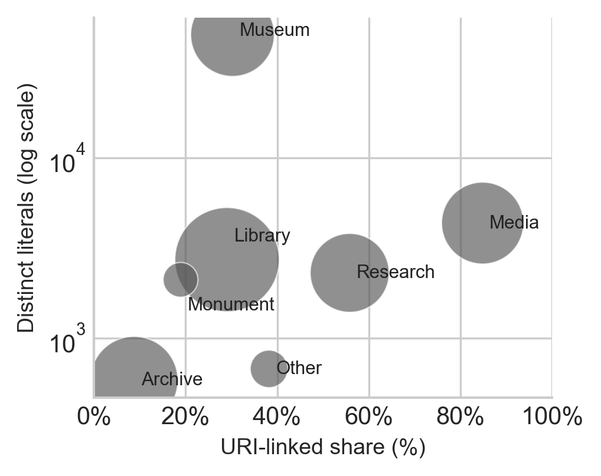

# dc:type Corpus Analysis

## 1. Scope

The *dc:type* field is the primary object-type signal in the DDB's EDM-based metadata: it carries either an authority URI resolving to a controlled vocabulary term or a free-text literal, depending on the contributing institution. A corpus-wide analysis of the sector-level [parquet files](parquet-source.md) yields 24.6 million *dc:type* entries across 658 providers in seven sectors. Of these, 7.97 million (32.4%) are authority-linked (stored with `is_ext_uri=True`), and the remaining 16.6 million (67.6%) are unlinked literals. The analysis treats URI-linked and literal entries as structurally distinct: the former carry a resolved preferred label from an external authority, while the latter reflect free-text annotation practice that varies by institution, region, and tradition.

| Metric | Value |
|--------|-------|
| Total *dc:type* entries | 24,616,731 |
| URI entries (`is_ext_uri=True`) | 7,968,700 (32.4%) |
| Literal entries (`is_ext_uri=False`) | 16,648,031 (67.6%) |
| Providers | 658 |

**Note**: URI entries store the resolved prefLabel as `name`; the authority URI is retained in `concept_labels.duckdb` for later enrichment. Entries with an external URI but no resolvable label in the same record are omitted from the [parquet](parquet-source.md).

## 2. Sector-level variation in authority linking

| Sector | URI entries | Literal entries | Distinct literals | URI% |
|--------|-------------|-----------------|-------------------|------|
| Archive | 266,868 | 2,778,940 | 582 | 9% |
| Library | 4,637,723 | 11,322,551 | 2,724 | 29% |
| Monument | 20,107 | 86,261 | 2,105 | 19% |
| Research | 798,022 | 631,512 | 2,300 | 56% |
| Media | 1,560,596 | 279,042 | 4,349 | 85% |
| Museum | 640,313 | 1,476,855 | 48,484 | 30% |
| Other | 45,071 | 72,870 | 673 | 38% |

Authority-linking rates span 9% in Archive to 85% in Media Library — a nine-fold range that reflects qualitatively different cataloguing practices across sectors, not volume differences. The Media Library sector approaches full controlled-vocabulary coverage: 1.56 million of its 1.84 million *dc:type* entries carry URIs, indicating systematic authority linking at the point of ingest. Archive sits at the opposite extreme: 91% of its 3.05 million entries are free-text literals, with only 582 distinct values — sparse and homogeneous, because structural metadata is encoded in *hierarchy_type* rather than *dc:type*. Monument Preservation (19% URI) and Library (29% URI) fall in a middle range where authority linking exists but is not the norm, reflecting legacy catalog records without retroactive authority enrichment.

Research is the one sector that is evenly split (56% URI, 44% literal), with a relatively high distinct literal count of 2,300 for its moderate volume of 1.43 million entries. Research institutions in Germany contribute from their own disciplinary vocabularies, producing annotation heterogeneity that no single controlled scheme covers.

## 3. Volume asymmetry and the Library sector

Library dominates the corpus: its 15.96 million *dc:type* entries account for 65% of the total, yet only 29% are authority-linked. For downstream knowledge graph construction, this means the majority of *dc:type* annotations in the DDB — more than ten million entries — originate from Library and carry no authority URI. These literals are often drawn from MARC-derived type vocabularies but provide no URI-level interoperability. Library's bar in Fig. 1 is the widest by a margin of 7×, yet its URI share is comparable to Museum's — volume does not predict linking rate.

## 4. Museum as an outlier in literal heterogeneity

Museum presents a distinct profile from every other sector. With 48,484 distinct literal values across 1.48 million literal entries — roughly 21 times more than the next most heterogeneous sector (Media Library, 4,349) — *dc:type* in Museum reflects institution-specific annotation at a scale that normalization cannot resolve. Controlled terms do exist (30% URI rate), but they coexist with a long tail of free-text values that differ across collections. In the heterogeneity space (Fig. 2), Museum occupies an isolated position: no other sector combines low URI share with high distinct-literal count at this volume. For GeMeA's entity-type facet, Museum literals represent the highest-cost normalization target.

