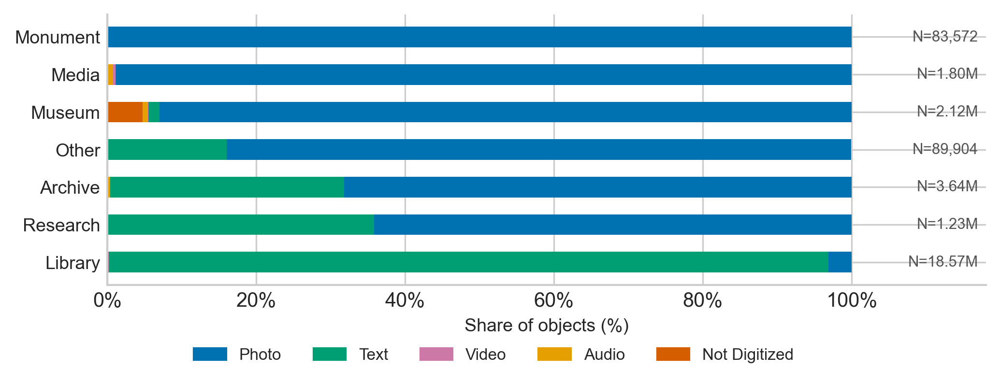
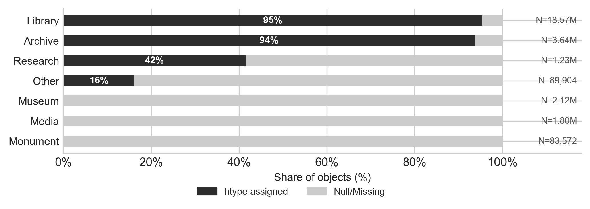
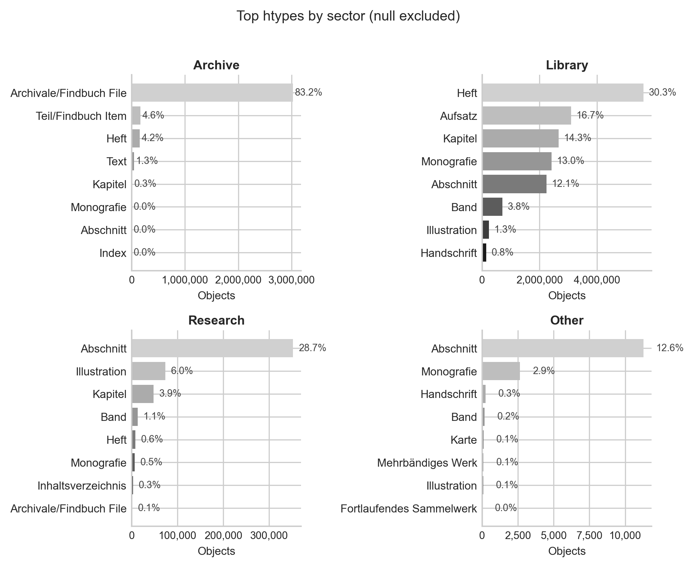

# mediatype and hierarchy_type Corpus Analysis

## 1. Scope

`mediatype` and `hierarchy_type` (*htype*) are integer-encoded fields in the sector parquet files, assigned at ingest from the DDB's EDM-based metadata. `mediatype` classifies each object by its primary format — Audio, Photo, Text, Video, or Not Digitized — and is populated for virtually all 27.5 million objects in the corpus (66 nulls, < 0.001%). *htype* encodes DDB's structural and bibliographic type hierarchy across 25 codes drawn from two distinct vocabularies: a bibliographic set (Monografie, Heft, Aufsatz, Kapitel, Abschnitt, and others) used in Library, and an archival set (Archivale/Findbuch File, Teil/Findbuch Item, Bestand, and others) used in Archive. Unlike `mediatype`, *htype* is not uniformly populated: 5.9 million objects (21.4%) carry no assignment, and three sectors — Monument, Media Library, and Museum — have zero coverage.

| Metric | Value |
|--------|-------|
| Total objects | 27,526,560 |
| Distinct mediatypes | 5 |
| Objects with null mediatype | 66 (< 0.001%) |
| Distinct htypes | 25 |
| Objects with null htype | 5,888,678 (21.4%) |

## 2. Mediatype: Photo dominates; Library is the exception

Six of seven sectors are majority Photo. Monument (100%) and Media Library (99%) are Photo-only in practice. Archive (68% Photo) and Research (64% Photo) carry a Text component alongside — digitized physical materials combined with finding aids and transcriptions in Archive, and digitized publications in Research — but Photo remains the plurality in both. The pattern breaks at Library: 96.7% of its 18.6 million objects are Text, the largest single-sector mass in the corpus and the primary driver of the corpus-wide text share. In every other sector, Text is a minor category.

| Sector | Photo | Text | Audio | Video | Not Digitized |
|--------|-------|------|-------|-------|---------------|
| Archive | 68.1% | 31.5% | 0.3% | 0.0% | 0.0% |
| Library | 3.1% | 96.7% | 0.0% | 0.2% | 0.0% |
| Monument | 100.0% | 0.0% | 0.0% | 0.0% | 0.0% |
| Research | 64.2% | 35.8% | 0.1% | 0.0% | 0.0% |
| Media | 98.8% | 0.1% | 0.8% | 0.3% | 0.0% |
| Museum | 93.0% | 1.5% | 0.7% | 0.0% | 4.7% |
| Other | 83.9% | 16.0% | 0.0% | 0.0% | 0.0% |

Audio and Video are marginal across all sectors. Media Library holds the largest Audio share (0.8%, 14K objects) and the only Video count worth noting (5,462); no other sector reaches 1% for either. For GeMeA's retrieval model, both types can be treated as special cases rather than primary facet values.

Museum is the only sector with a meaningful Not Digitized share: 100,331 objects (4.7%) carry this flag, indicating physical holdings for which no digital surrogate exists. These objects are present in the metadata collection but have no retrievable digital content, a distinction that affects both search and facet construction.

## 3. htype coverage is sector-local, not corpus-wide

Monument, Media Library, and Museum — 4.0 million objects combined — have zero *htype* coverage. Archive and Library are near-complete (94% and 95% respectively). Research and Other are majority null (59% and 84% null). The result is that *htype* cannot be used as a cross-sector signal: any query conditioned on *htype* values silently excludes more than half the corpus.

Within the four sectors that use *htype*, coverage rates are not the product of data quality variation but of deliberate metadata practice. Monument, Media Library, and Museum do not assign *htype* in the DDB model; structural typing in those sectors, where it exists at all, is expressed through other fields. Research's low coverage (41%) reflects the distributed nature of research collection cataloguing: many contributing repositories do not apply DDB's type hierarchy at the object level.

## 4. Archive and Library use distinct type vocabularies

Archive and Library both have high *htype* coverage, but their type sets do not overlap semantically. Archive is dominated by EAD-derived archival types: 83% of its objects carry Archivale/Findbuch File, with Teil/Findbuch Item (4.6%) and Heft (4.2%) accounting for most of the remainder. Library distributes across 25 bibliographic types — Heft (30%), Aufsatz (17%), Kapitel (14%), Monografie (13%), Abschnitt (12%) — with no single type exceeding a third of the sector. Research, where *htype* is assigned, uses a subset of Library's bibliographic vocabulary, with Abschnitt (29%) dominant, reflecting journal article and chapter-level objects from research repositories.

Library is the only sector where *htype* provides a dense and varied classification signal. Its 25 distinct types with no single dominant value make it the best-supported sector for type-conditioned retrieval and classification experiments. For Archive, *htype* is functionally a binary signal — Archivale/Findbuch File vs. everything else — rather than a fine-grained type vocabulary. For GeMeA, cross-sector type queries must therefore fall back to *dc:type* or `mediatype`; *htype* is reliable only within Library and, with reduced granularity, within Archive.
